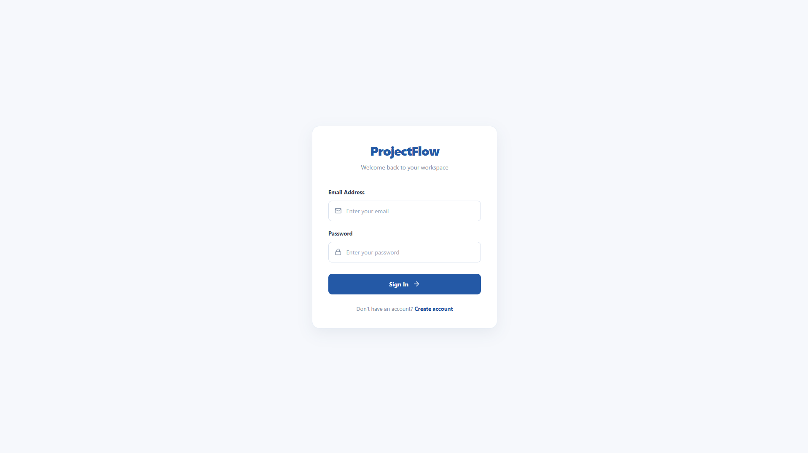
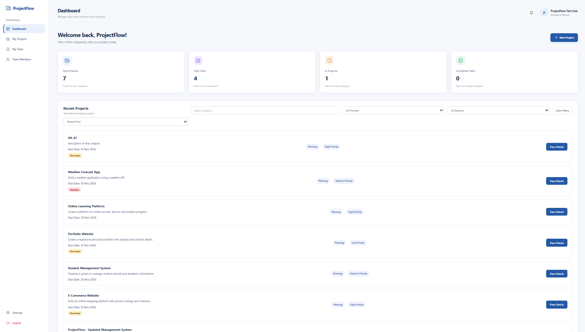
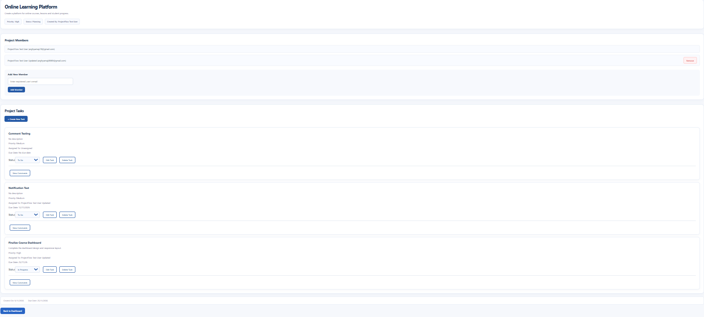
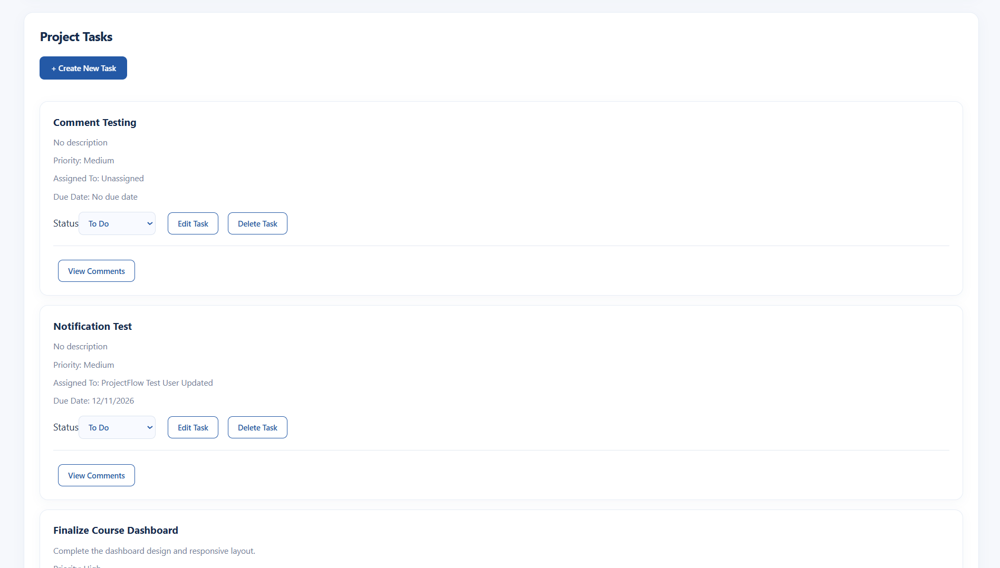
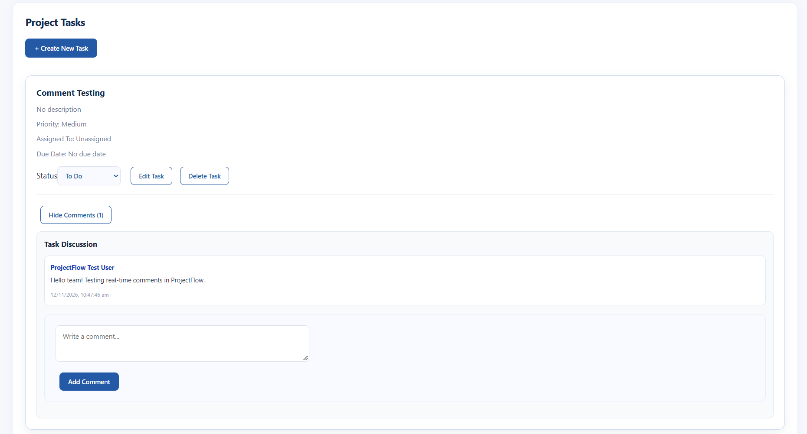
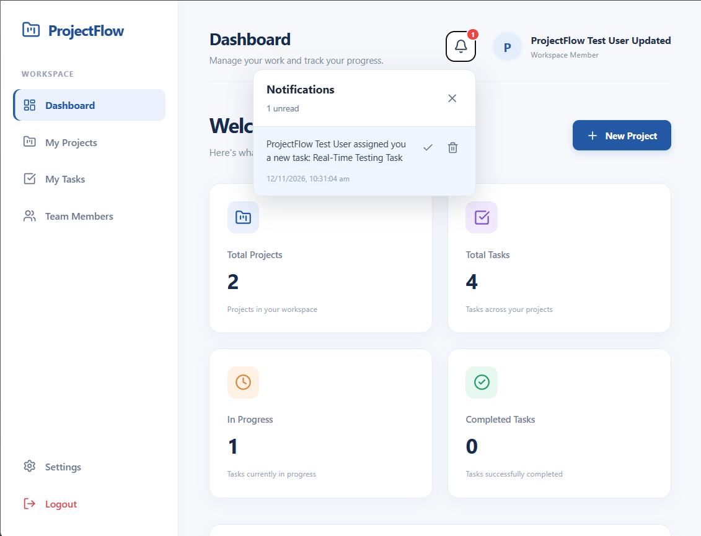
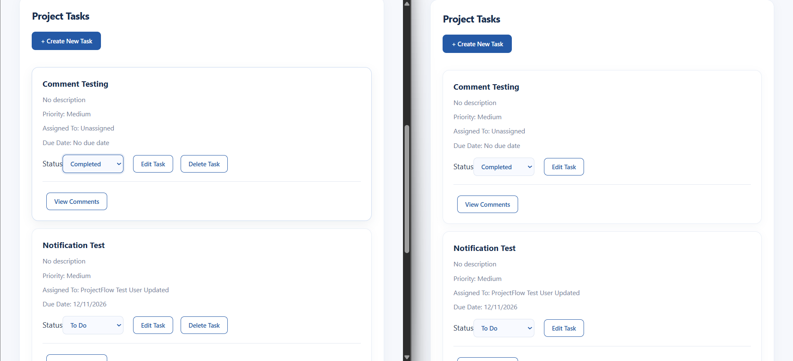

# ProjectFlow – Project Management Tool

ProjectFlow is a full-stack project management application built using the MERN stack. It helps teams organize projects, assign tasks, manage team members, and communicate through task discussions.

It also supports real-time collaboration using Socket.IO, allowing project members to see task updates and new comments without refreshing the page.

## Features

### Authentication
- User registration and login
- JWT-based authentication
- Protected routes
- Profile and password management

### Project Management
- Create and manage projects
- View project details
- Add and remove team members
- Manage project information and status

### Task Management
- Create, edit, and delete tasks
- Assign tasks to team members
- Set task priorities and due dates
- Track task status
- View personal tasks

### Team Collaboration
- Task comments and discussions
- Notification system
- Real-time task creation and updates
- Real-time task status changes
- Real-time task deletion
- Real-time comment updates

## Technology Stack

**Frontend**
- React.js
- Vite
- JavaScript
- CSS

**Backend**
- Node.js
- Express.js
- MongoDB
- Mongoose
- JWT Authentication
- Socket.IO

**Development Tools**
- VS Code
- Git
- GitHub
- Thunder Client

## Project Structure

```text
CodeAlpha_ProjectManagementTool/
│
├── client/
│   ├── src/
│   ├── public/
│   └── package.json
│
├── server/
│   ├── config/
│   ├── controllers/
│   ├── middleware/
│   ├── models/
│   ├── routes/
│   └── package.json
│
├── .gitignore
└── README.md
```

## Installation and Setup

### 1. Clone the repository

```bash
git clone YOUR_GITHUB_REPOSITORY_URL
cd CodeAlpha_ProjectManagementTool
```

### 2. Set up the backend

```bash
cd server
npm install
```

Create a `.env` file inside the `server` folder:

```env
PORT=5000
MONGO_URI=your_mongodb_connection_string
JWT_SECRET=your_secret_key
```

Start the backend:

```bash
npm run dev
```

The backend will run at:

`http://localhost:5000`

### 3. Set up the frontend

Open another terminal:

```bash
cd client
npm install
npm run dev
```

The frontend will run at:

`http://localhost:5173`

## Database

ProjectFlow uses MongoDB with Mongoose for storing and managing application data.

Add your own MongoDB connection string to the backend `.env` file before starting the application.

## Real-Time Collaboration

ProjectFlow uses Socket.IO for real-time communication between project members.

When a member creates, edits, updates, or deletes a task, other members viewing the same project receive the changes automatically.

New task comments are also synchronized in real time.

## Screenshots

### 1. Login Page


### 2. Dashboard


### 3. Project Details


### 4. Task Management


### 5. Task Comments


### 6. Notifications


### 7. Real-Time Collaboration



## Internship Project

**Program:** CodeAlpha Full Stack Development Internship

**Project:** Task 3 – Project Management Tool

## Author

**Arghya Maji**

